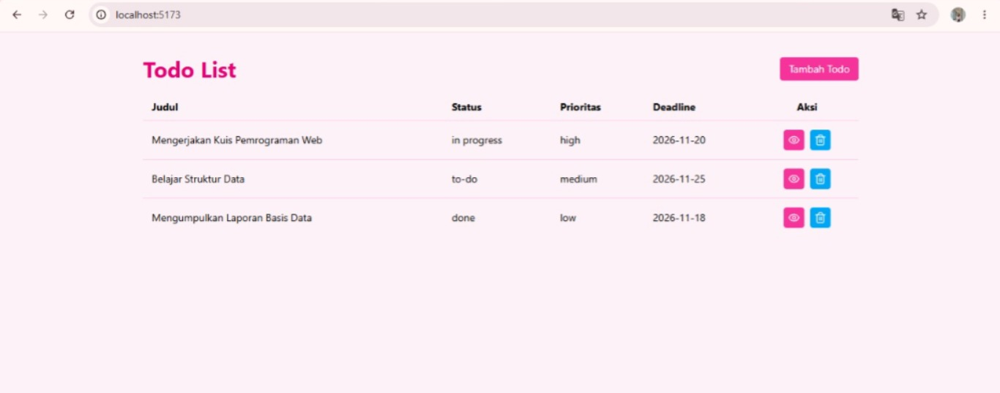
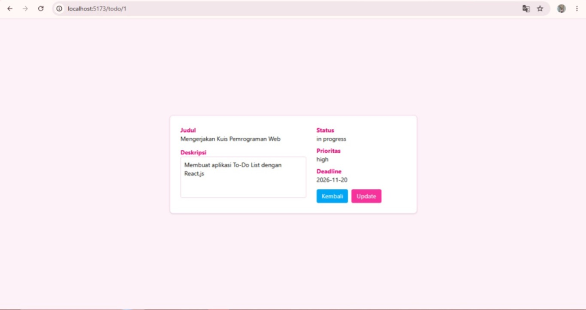
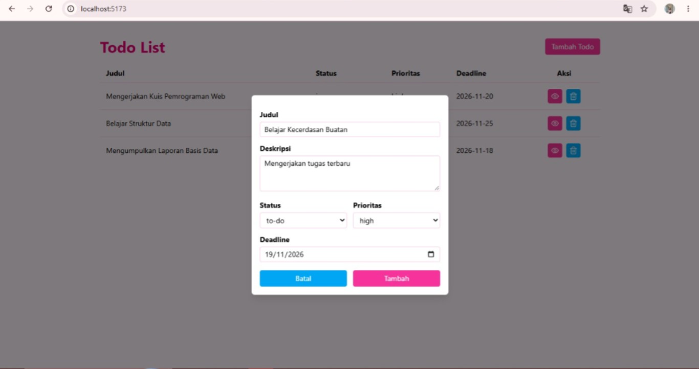
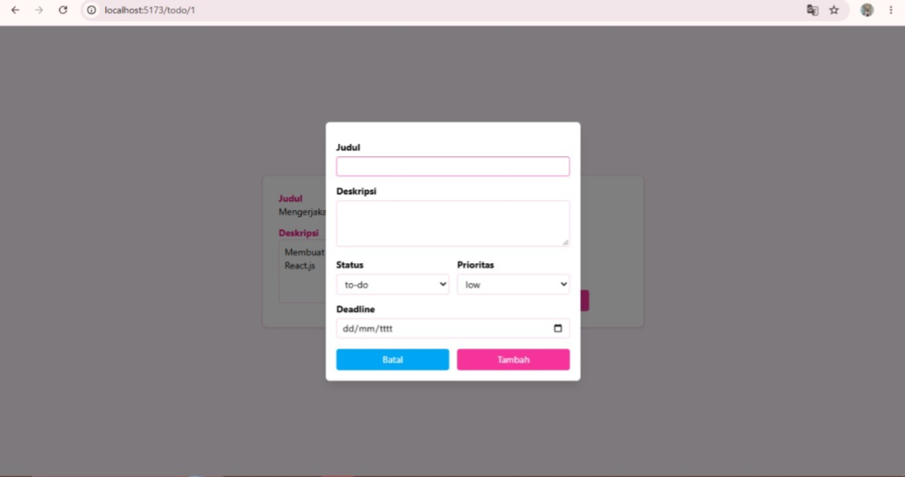
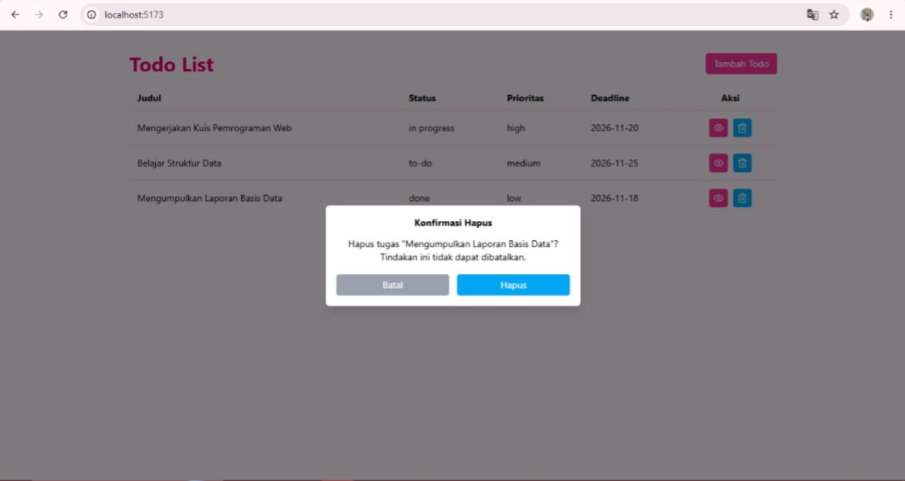

# Todo List Application

## Deskripsi Aplikasi

Todo List merupakan aplikasi frontend berbasis React.js yang digunakan untuk membantu pengguna dalam mengelola daftar tugas. Aplikasi ini memungkinkan pengguna untuk menambahkan, melihat, memperbarui, dan menghapus tugas dengan tampilan yang sederhana dan mudah digunakan.

## Fitur Aplikasi

Aplikasi ini memiliki beberapa fitur utama:

1. **Menampilkan Daftar Tugas**  
   Menampilkan seluruh daftar tugas beserta informasi status, prioritas, dan deadline.

2. **Melihat Detail Tugas**  
   Menampilkan informasi lengkap dari tugas yang dipilih.

3. **Menambahkan Tugas**  
   Memungkinkan pengguna menambahkan tugas baru melalui form.

4. **Memperbarui Tugas**  
   Memungkinkan pengguna mengubah informasi tugas yang sudah ada.

5. **Menghapus Tugas**  
   Memungkinkan pengguna menghapus tugas dengan konfirmasi sebelum penghapusan.

## Struktur Data

Setiap tugas memiliki beberapa atribut:

| Atribut | Keterangan |
|---|---|
| id | Identitas unik tugas |
| title | Judul tugas |
| description | Deskripsi tugas |
| priority | Prioritas tugas |
| deadline | Batas waktu pengerjaan |
| status | Status pengerjaan tugas |

## Screenshot Aplikasi

### 1. Menampilkan Daftar Tugas

### 2. Melihat Detail Tugas

### 3. Menambahkan Tugas

### 4. Memperbarui Tugas

### 5. Menghapus Tugas
